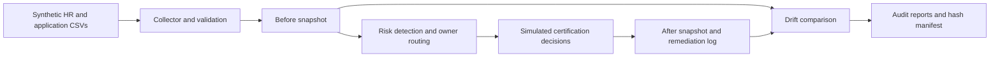

# Architecture

The business problem is unreviewed access accumulating across applications. This lab inventories assignments, routes review to application owners, detects risk, records certification decisions, and verifies simulated remediation.

Boundary: all processing is local. No cloud identity tenant, database, credentials, or privileged service connection is required. Governance is a custom Python workflow chosen for accessibility and reproducibility. It demonstrates IGA concepts without claiming SailPoint capability or licensed access. Project 1 exports were not supplied; the CSV contract is the future integration boundary.

RBAC baseline maps Finance to Ledger, HR to People, IT to Directory, Sales to CRM, and Operations to ServiceDesk reader access. Each application has reader, editor, requester, approver, and admin entitlements. M0–M4 are synthetic application owners. Model entities: identities, applications (derived from entitlements), entitlements, assignments, reviewers, decisions, findings, snapshots, remediation events. Separate persisted role and account entities and identity lifecycle integration are future extensions.
